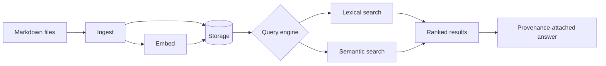
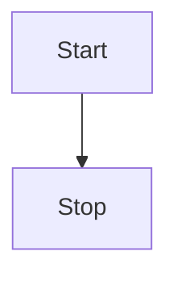

# Mermaid Flowchart

The ingest-to-answer pipeline:

A second, tiny diagram in the same file:

Prose after the diagrams so it is not the last block. Related:
[sequence diagram](mermaid-sequence.md).
