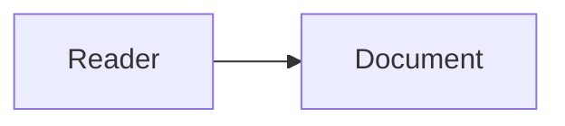

# Markdown navigation acceptance

This corpus contains public synthetic text only.

| Destination | Expected behavior |
| --- | --- |
| [Nested note](docs/Next%20note.md) | Open the exact readable note |
| [Second repeated heading](docs/Next%20note.md#repeated-1) | Jump to the second Repeated section |
| [Unicode heading](docs/Next%20note.md#caf%C3%A9) | Jump to Café |
| [Footnote](docs/Next%20note.md#fn-one) | Jump to the definition |
| [Missing heading](docs/Next%20note.md#absent) | Read the note with an unavailable-location notice |
| [Missing document](missing.md) | Report unavailable, preserve this reader |
| [Large document](large.md#section-309) | Mount and jump to the distant section |
| [External website](https://example.com) | Open the default browser |
| [SQL attachment](assets/public.sql) | Preview escaped read-only SQL text |
| [Deployment attachment](assets/public.bicep) | Preview deployment text without running it |
| [YAML attachment](assets/public.yaml) | Preview configuration text |
| [Drawio attachment](assets/public.drawio) | Preview its XML as text |
| [Image attachment](assets/diagram.png) | Preview the bounded image |

## Same document

[This section](#same-document), [the definition](#fn-local), and [reference link][nested] remain clickable. A fact[^local] also links to its definition and back.

[^local]: Public footnote definition.

[nested]: docs/Next%20note.md#repeated-1


**Strong**, *emphasis*, ~~removed~~, `inline code`, and <https://example.com>.

> A public quotation.

- [x] Completed item
- [ ] Open item

1. First ordered item
2. Second ordered item

Inline math: $x^2 + y^2$.

```typescript
const publicMessage = 'Markdown reader';
```



[[Next note#Repeated|Wikilink to the note]]
